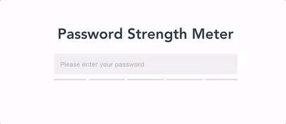

# 🔓 vue-password-strength-meter

[](https://badge.fury.io/js/vue-password-strength-meter)
[](https://vuejs.org/)
[](https://github.com/apertureless/vue-password-strength-meter/blob/master/LICENSE.txt)

[](https://ko-fi.com/C0C1WP7C)

Interactive password strength meter based on [zxcvbn](https://github.com/dropbox/zxcvbn) for vue.js

<p align="center">
  
</p>

## 📺 Demo

[Demo here](https://apertureless.github.io/vue-password-strength-meter/)

## 🔧 Install

`yarn add vue-password-strength-meter zxcvbn`

## 👈 Usage

```javascript

<template>
  <password v-model="password"/>
</template>

<script>
  import Password from 'vue-password-strength-meter'
  import 'vue-password-strength-meter/style.css'

  export default {
    components: { Password },
    data: () => ({
      password: null
    })
  }
</script>

```
## 👈 With events

```javascript

<template>
  <password
    v-model="password"
    :toggle="true"
    @score="showScore"
    @feedback="showFeedback"
  />
</template>

<script>
  import Password from 'vue-password-strength-meter'
  import 'vue-password-strength-meter/style.css'

  export default {
    components: { Password },
    data: () => ({
      password: null
    }),
    methods: {
      showFeedback ({suggestions, warning}) {
        console.log('🙏', suggestions)
        console.log('⚠', warning)
      },
      showScore (score) {
        console.log('💯', score)
      }
    }
  }
</script>
```

### With custom input

```html
<template>
  <div>
    <input type="password" v-model="password">
    <password v-model="password" :strength-meter-only="true"/>
  </div>
</template>

<script>
  import Password from 'vue-password-strength-meter'
  import 'vue-password-strength-meter/style.css'

  export default {
    components: { Password },
    data: () => ({
      password: null
    })
  }
</script>
```

### Composition API

```html
<template>
  <password v-model="password" />
</template>

<script setup>
  import { ref } from 'vue'
  import Password from 'vue-password-strength-meter'
  import 'vue-password-strength-meter/style.css'

  const password = ref(null)
</script>
```

## Props

| Prop   |      Type      |  Default Value | Description
|----------|:-------------:|------|------|
| secureLength |  Number | 7 | password min length |
| badge |  Boolean | true | display password count badge |
| toggle |  Boolean | false | show button to toggle password visibility |
| showPassword |  Boolean | false | If you are not using the `toggle` button you can directly show / hide the password with this prop |
| defaultClass |  String | Password__field | input field class |
| disabledClass |  String | Password__field--disabled | disabled input field class |
| errorClass |  String | Password__badge--error | error class for password count badge |
| successClass |  String | Password__badge--success | success class for password count badge |
| strengthMeterClass |  String | Password__strength-meter | strength-meter class |
| strengthMeterFillClass |  String | Password__strength-meter--fill | strength-meter class for individual data fills |
| showStrengthMeter |  Boolean | true | Hide the Strength Meter if you want to implement your own |
| strengthMeterOnly |  Boolean | false | Hides the built-in input if you want to implement your own |
| labelHide |  String | 'Hide Password' | Label for the hide icon
| labelShow |  String | 'Show Password' | Label for the show icon
| userInputs | Array | empty array | Array of strings that zxcvbn will treat as an extra dictionary
| referenceValue | String | 'input' | Prop to change the `ref` of the input. This way you can have the input outside of the component.

## Events

### Show / Hide Password

- `@show` will be emitted if showing the password
- `@hide` will be emitted if hiding the password
- `@score` will return the zxcvbn score (Integer from 0-4) [ℹ] (https://github.com/dropbox/zxcvbn#usage)
- `@feedback` will return an zxcvbn feedback object with `suggestion` and `warning`


## 💅 Customizing

You can customize the styling of the input field, badge and strength-meter by passing your own css classes
to `defaultClass`, `strengthMeterClass` etc.

## Build Setup

``` bash
# install dependencies
npm install

# serve with hot reload
npm run dev

# build for production with minification
npm run build

# run tests
npm test
```


## Support

<a href="https://www.buymeacoffee.com/xcqjaytbl" target="_blank"></a>
